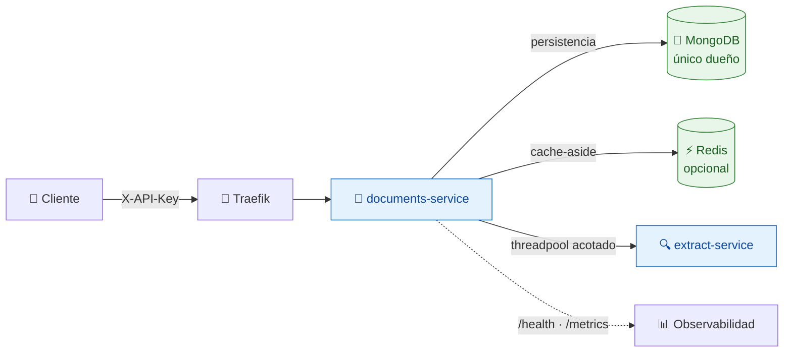
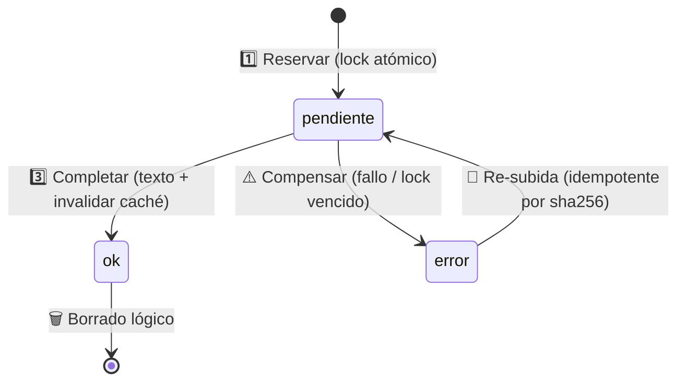

<div align="center">

# 📄 pdf-documents-service

**El único componente con acceso a MongoDB en el poly repo _PDF Extract_.**  
El resto de los servicios deben usar esta API para persistir, consultar y descargar documentos.


[Visión general](#-visión-general) · [12 Factor](#-estado-de-los-12-factor-app) · [Resiliencia](#-patrones-de-resiliencia) · [API](#-api) · [Seguridad](#-seguridad) · [Desarrollo](#-desarrollo-y-despliegue)

</div>

---

## 🧭 Índice

<details>
<summary>Haz clic para desplegar</summary>

1. [🎯 Visión general](#-visión-general)
   - [Arquitectura](#arquitectura)
   - [Ciclo de vida de un documento](#ciclo-de-vida-de-un-documento)
2. [✅ Estado de los 12 Factor App](#-estado-de-los-12-factor-app)
3. [🛡️ Patrones de resiliencia](#-patrones-de-resiliencia)
   - [Saga de upload](#saga-de-upload)
   - [Circuit breaker](#circuit-breaker)
   - [Bulkhead y reintentos](#bulkhead-y-reintentos)
   - [Caché](#caché)
4. [🔌 API](#-api)
   - [Seguridad](#-seguridad)
5. [🚀 Desarrollo y despliegue](#-desarrollo-y-despliegue)
   - [Configuración](#configuración)
   - [Producción](#producción)

</details>

---

## 🎯 Visión general

| 🧱 Runtime | 🗄️ Persistencia | 🧯 Resiliencia |
|:---:|:---:|:---:|
| Python 3.14 · FastAPI · MongoDB · Redis (opcional pero recomendado) | Deduplicación por `sha256`, borrado lógico y máquina de estados `pendiente → ok \| error` | Saga de upload, circuit breaker, bulkhead, reintentos con backoff y caché cache-aside |

### Arquitectura



### Ciclo de vida de un documento



> [!TIP]
> El `checksum` único convierte cualquier re-intento en una operación idempotente: el mismo PDF nunca se duplica.

---

## ✅ Estado de los 12 Factor App

| # | Factor | Cómo se cumple |
|:-:|---|---|
| I | 🗂️ Codebase | Un repo, un servicio, dependencias fijadas en `uv.lock`. |
| II | 📦 Dependencias | Declaradas en `pyproject.toml`; el Dockerfile instala con `uv sync --frozen`. Versión de `uv` fijada (`UV_VERSION`). |
| III | ⚙️ Config | Toda la configuración disponible por variables de entorno (`app/settings.py`, ver `.env.example`). Sin secretos en el código; `mongodb_uri`, `redis_url` y contraseñas se ocultan en `repr`. |
| IV | 🔌 Backing services | MongoDB, Redis y el servicio extract son recursos adjuntos configurables por URL. |
| V | 🏗️ Build, release, run | Imagen multi-stage: builder → runtime. `APP_VERSION` como etiqueta OCI, arranque `exec uvicorn`, `PORT` y `WEB_CONCURRENCY` por entorno. |
| VI | ⚖️ Procesos | Procesos stateless. Los clientes (Mongo/httpx) son pools compartidos, no estado de negocio; el estado de la saga vive en MongoDB. |
| VII | 🌐 Port binding | Uvicorn hace bind a `0.0.0.0:$PORT` dentro del contenedor. |
| VIII | 🧵 Concurrencia | Requests sync en threadpool + `run_in_threadpool`; locks atómicos en Mongo para sagas concurrentes; bulkhead limita la presión sobre el extract. |
| IX | ♻️ Disposabilidad | `/health/live` y `/health/ready`, `HEALTHCHECK` en la imagen, cierre ordenado de clientes y de la tarea de recuperación en `lifespan`. |
| X | 🧪 Dev/prod parity | `docker-compose.dev.yml`, `.env.example` y creación idempotente de índices en el arranque (antes era un script manual). |
| XI | 📝 Logs | Logs JSON a stdout con `request_id`, duración, método y status por request; nivel y formato configurables. |
| XII | 🛠️ Admin processes | `app/admin/create_indexes.py` sigue disponible como tarea one-off con la misma configuración. |

---

## 🛡️ Patrones de resiliencia

### 1️⃣ Saga de upload

`POST /documents/upload` ejecuta una saga con tres pasos y compensación:

1. **Reservar** — se inserta el documento en `estado="pendiente"` con un lock de saga (`owner`, `locked_at`, `attempts`). El lock se reclama con `find_one_and_update` atómico: si otro worker ya lo tiene, se espera un intervalo acotado y se devuelve `409 + Retry-After`.
2. **Extraer** — llamada al servicio extract con circuit breaker + bulkhead + reintentos.
3. **Completar** — se escribe el texto y se pasa a `estado="ok"`, liberando el lock e invalidando la caché.

Si falla el paso 2 o el 3, la **compensación** marca el documento como `error`, guarda el motivo, libera el lock e invalida la caché. Una tarea de recuperación compensa en el arranque y periódicamente las sagas huérfanas (lock vencido / worker caído).

> [!IMPORTANT]
> **Limitación deliberada:** el PDF original no se persiste, por lo que la recuperación no puede repetir la extracción; compensa a `error` y el cliente puede re-subir el mismo archivo. El `checksum` único garantiza que ese re-intento sea idempotente y no duplique documentos.

### 2️⃣ Circuit breaker

Envoltorio del extract (`app/services/extract_resilience.py`) con estados `closed → open → half_open`:

- `CIRCUIT_BREAKER_FAILURE_THRESHOLD` fallos consecutivos abren el breaker.
- Tras `CIRCUIT_BREAKER_RECOVERY_TIMEOUT_S` se permite una sonda; si falla vuelve a abrirse.
- Un `InvalidPDFError` **no** cuenta como fallo del dependiente (es una respuesta válida).
- Abierto o saturado → `503 + Retry-After`, sin salir hacia el extract.
- Consultable en `/health/ready` y `/metrics`.

### 3️⃣ Bulkhead y reintentos

- `EXTRACT_MAX_CONCURRENCY` limita las llamadas simultáneas al extract; el exceso se rechaza de inmediato con `503 + Retry-After`.
- Reintentos exponenciales con jitter para timeouts y errores de transporte. Si el extract devuelve `Retry-After` mayor al techo local (`EXTRACT_RETRY_MAX_DELAY_S`), se propaga de inmediato para no dormir un worker.
- Los errores de contenido (PDF inválido) nunca se reintentan.

### 4️⃣ Caché

- **Cache-aside** en las consultas por id, checksum y listados.
- Backend Redis cuando se define `REDIS_URL` (recomendado con más de un worker / detrás de Traefik); caché LRU en memoria en caso contrario.
- TTL (`CACHE_TTL_S`) e invalidación explícita en upload, PATCH y DELETE.
- Si Redis falla, se sigue sirviendo desde MongoDB y el evento se registra en `/metrics` (`cache.backend_error`): la caché nunca es un punto único de fallo.

---

## 🔌 API

| Método | Ruta | Descripción |
|:---:|---|---|
| `GET` | `/health` | Health legado (siempre `ok`). |
| `GET` | `/health/live` | Liveness del proceso. |
| `GET` | `/health/ready` | Mongo + breaker; `503` si no está listo. La caché se reporta pero no bloquea. |
| `GET` | `/metrics` | Contadores/gauges de breaker, bulkhead, reintentos, caché y sagas. |
| `POST` | `/documents/upload` | Sube un PDF y ejecuta la saga. |
| `GET` | `/documents` | Lista documentos (paginada). |
| `GET` | `/documents/{id}` | Obtiene un documento. |
| `GET` | `/documents/by-checksum/{checksum}` | Busca por checksum. |
| `GET` | `/documents/{id}/download` | Descarga el texto extraído. |
| `PATCH` | `/documents/{id}` | Actualiza campos/estado (transiciones atómicas). |
| `DELETE` | `/documents/{id}` | Borrado lógico. |

Todas las respuestas incluyen `X-Request-ID`. Si Traefik envía `X-Request-ID` o `X-Correlation-ID`, se reutiliza para correlacionar trazas entre servicios.

| Código | Significado |
|:---:|---|
| `400` | PDF inválido |
| `409` | Saga en curso |
| `502` | Extract caído |
| `503` | Extract saturado o breaker abierto |
| `504` | Timeout del extract |

### 🔒 Seguridad

- [x] **Autenticación** — si `APP_API_KEY` está configurada, todas las rutas `/documents` y `/metrics` exigen `X-API-Key` (o `Authorization: Bearer`) con comparación de tiempo constante. Las sondas `/health*` quedan abiertas para los healthchecks. **En producción la clave es obligatoria**; si está vacía la API funciona sin auth (sólo desarrollo local).
- [x] **Abuso** — `APP_RATE_LIMIT_PER_MINUTE` limita por IP (recomendado `120`). El upload rechaza por `Content-Length`, lee por chunks con corte en `APP_MAX_PDF_SIZE_BYTES` y valida el magic bytes `%PDF-`; el spool nunca supera ese máximo.
- [x] **Exposición** — el serializer no devuelve `saga.*` (dueño/hostname/PID, errores internos). `/docs`, `/redoc` y `/openapi.json` están desactivados salvo `APP_DOCS_ENABLED=true`. `Retry-After` se acota a 1-30 s y los errores del extract se sanean antes de reenviarse o persistirse.
- [x] **Configuración** — en contenedores `APP_DISABLE_DOTENV=1` evita que un `.env` local redirija clientes. Usar `mongodb://...?tls=true`, `rediss://` y `https://` en producción; el compose de desarrollo publica Mongo/Redis sólo en loopback y con credenciales.
- [x] **Supply chain** — imágenes base e instalador fijados por digest, GitHub Actions fijadas por SHA, `pip-audit` como gate del workflow y publicación por digest inmutable.

---

## 🚀 Desarrollo y despliegue

```bash
uv sync --frozen
uv run pytest -q
docker compose -f docker-compose.dev.yml up --build
```

Copiar `.env.example` a `.env` y ajustar.

### Configuración

Los grupos principales (ver [`.env.example`](.env.example) para el listado completo):

| Grupo | Variables clave |
|---|---|
| App | `PORT`, `WEB_CONCURRENCY`, `APP_LOG_LEVEL`, `APP_LOG_FORMAT`, `APP_MAX_PDF_SIZE_BYTES` |
| Seguridad | `APP_API_KEY`, `APP_RATE_LIMIT_PER_MINUTE`, `APP_DOCS_ENABLED`, `APP_DISABLE_DOTENV` |
| Datos | `MONGODB_URI`, `MONGODB_DB_NAME`, `REDIS_URL`, `CACHE_TTL_S` |
| Extract | `EXTRACT_SERVICE_URL`, `EXTRACT_TIMEOUT_S`, `EXTRACT_MAX_ATTEMPTS`, `EXTRACT_MAX_CONCURRENCY` |
| Breaker | `CIRCUIT_BREAKER_FAILURE_THRESHOLD`, `CIRCUIT_BREAKER_RECOVERY_TIMEOUT_S` |
| Saga | `SAGA_LOCK_TTL_S`, `SAGA_CLAIM_WAIT_S`, `SAGA_RECOVERY_INTERVAL_S`, `SAGA_RECOVERY_BATCH_SIZE` |

### Producción

El repo orquestador debe proveer:

- `MONGODB_URI` — acceso exclusivo de este servicio, con TLS y credenciales.
- `REDIS_URL` — compartida por todas las réplicas (`rediss://`).
- `EXTRACT_SERVICE_URL` — alcanzable desde la red de Traefik (HTTPS/mTLS).
- `APP_API_KEY` — secreta, inyectada también en Traefik para que el gateway y la app validen la misma credencial.
- `APP_RATE_LIMIT_PER_MINUTE`, `APP_DISABLE_DOTENV=1` y `APP_DOCS_ENABLED=false`.
- Rutas de healthcheck: `/health/live` (liveness) y `/health/ready` (readiness).
- Reenvío/generación de `X-Request-ID` en Traefik para correlación extremo a extremo.

> [!WARNING]
> Con `WEB_CONCURRENCY>1`, el circuit breaker y el bulkhead son **por proceso**; la caché debe ser Redis para que la invalidación sea coherente entre workers.

---

<div align="center">

Hecho con 🧠 y ☕ para el poly repo **PDF Extract** · Licencia [MIT](pyproject.toml)

</div>
